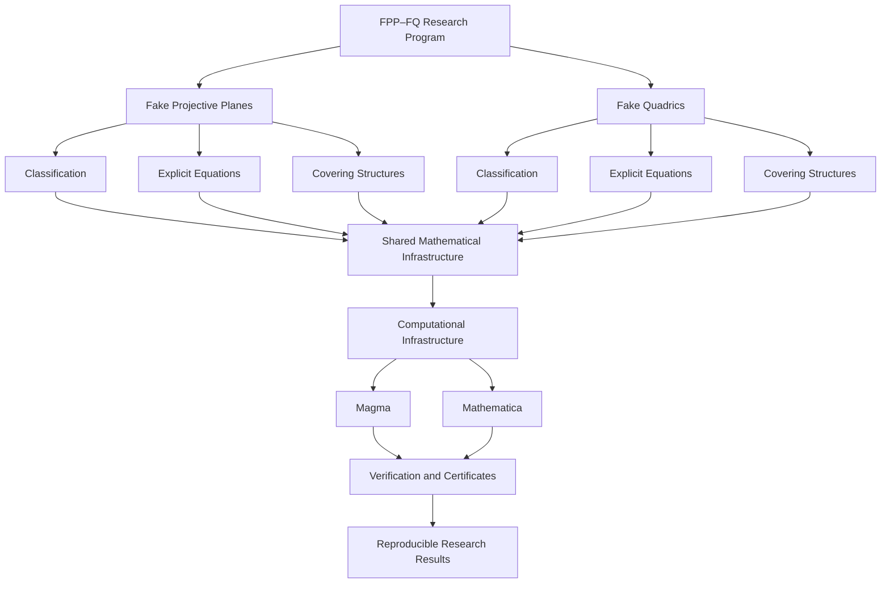
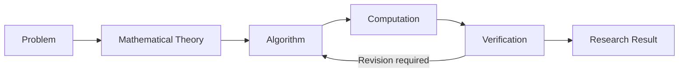

# Explicit Geometry of Fake Projective Planes and Fake Quadrics

This project studies how to pass from a description of a surface in a classification to explicit equations, group actions, and covering maps. Each research branch records the evidence that identifies a model with a particular surface.

## Mathematical foundation

Both branches study smooth minimal complex projective surfaces $X$ of general type with geometric genus $p_g(X)=0$ and irregularity $q(X)=0$. Their rational Betti numbers agree with those of the classical surfaces below. [Definitions and sources](shared/definitions/surfaces.md)

| Invariant | Fake projective plane (FPP) | Fake quadric (FQ) |
| --- | --- | --- |
| Classical counterpart | $\mathbb{P}^2$ | $\mathbb{P}^1 \times \mathbb{P}^1$ |
| Complex dimension | 2 | 2 |
| Geometric genus $p_g$ | 0 | 0 |
| Irregularity $q$ | 0 | 0 |
| Canonical self-intersection $K_X^2$ | 9 | 8 |
| Topological Euler characteristic $c_2(X)$ | 3 | 4 |
| Second Betti number $b_2$ | 1 | 2 |
| Holomorphic Euler characteristic $\chi(\mathcal{O}_X)$ | 1 | 1 |

The FQ branch uses the numerical definition above. A **bidisk-uniformized fake quadric** also has universal cover biholomorphic to $\mathbb{D} \times \mathbb{D}$, where $\mathbb{D}$ is the unit disk. Recording this property for a surface requires a construction or theorem that establishes its universal cover.

## Architectural principle

**Independent research branches. Shared mathematical foundations. Unified computational infrastructure.**



## Repository navigation

| To find | Open |
| --- | --- |
| Family-specific classifications, equations, groups, and covers | [Fake projective planes](fpp/) · [Fake quadrics](fq/) |
| Definitions, notation, theorems, algorithms, and metadata schema | [Shared mathematics](shared/) |
| Mathematical software and editor tasks | [Computational infrastructure](computational/) · [Shell scripts](scripts/) · [VS Code](.vscode/) |
| Source data, derived data, and certificates | [Data](data/) · [Certificates](data/certificates/) |
| Conventions and documentation | [Protocols](protocols/) · [Architecture](ARCHITECTURE.md) · [Documentation](docs/) · [Agent instructions](AGENTS.md) |
| Tests, research reports, and local execution logs | [Tests](tests/) · [Reports](reports/) · [Logs](logs/) |
| Bibliography and family-specific reading notes | [References](references/) · [FPP literature](fpp/literature/) · [FQ literature](fq/literature/) |

## Computation and reproducibility

Magma and Wolfram Mathematica run the exact computations. From a Bash terminal at the repository root, check the workspace and its navigation links, inspect the available interfaces, and run both polynomial-identity tests.

```bash
bash tests/check-workspace.sh
bash scripts/research.sh check
bash scripts/research.sh test all
```

In VS Code, open the repository folder in WSL, choose **Tasks: Run Task** from the Command Palette, and select **Run All Computational Tests**. For executable selection, individual tests, and recording a research computation, see the [computational guide](computational/README.md) and [reproducibility protocol](protocols/reproducibility.md).

## Research workflow and roadmap



The roadmap starts with one surface in each family. Identify it in a primary source, reproduce the data defining its model, and verify a named property. [Research milestones and required evidence](ROADMAP.md)

## Verification status

The smoke tests check $(x+1)^2=x^2+2x+1$ in exact arithmetic. The following outcomes describe the initialization run.

| Check | Status | Evidence |
| --- | --- | --- |
| Mathematica | **PASS** | WolframScript ran the script on the Windows 15.0.1 kernel, emitted `MATHEMATICA_SMOKE_TEST_OK`, and exited with status 0. [Test](computational/mathematica/tests/smoke.wls) |
| Magma | **BLOCKED** | The executable search found no runnable Magma interface. [Test](computational/magma/tests/smoke.m) |
| Surface-level claims | **NOT RUN** | Both registries are empty. [FPP registry](fpp/database/registry.json) · [FQ registry](fq/database/registry.json) |
